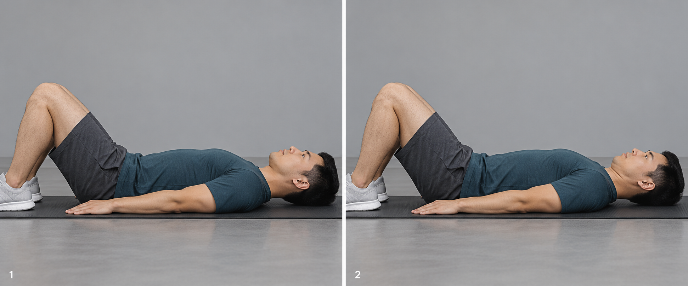
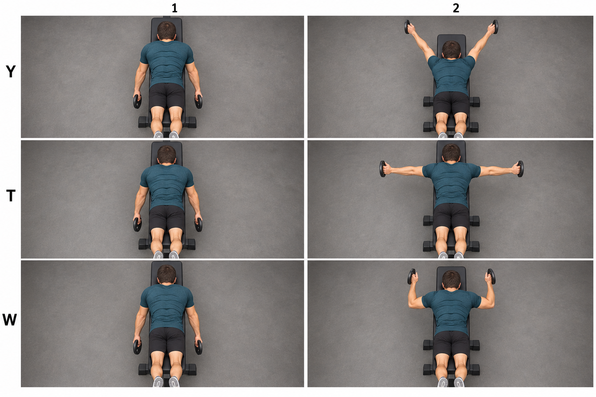
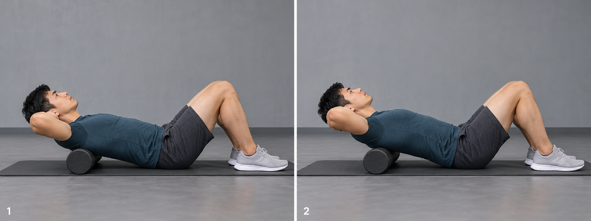
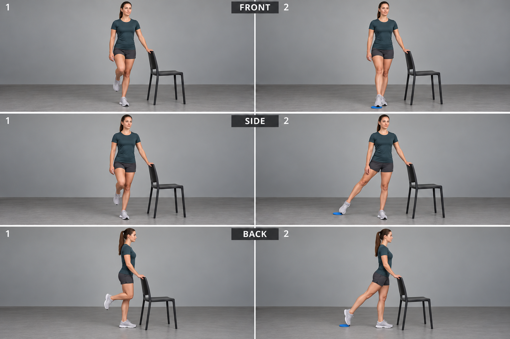
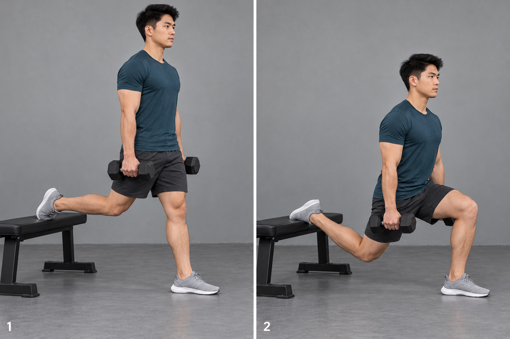
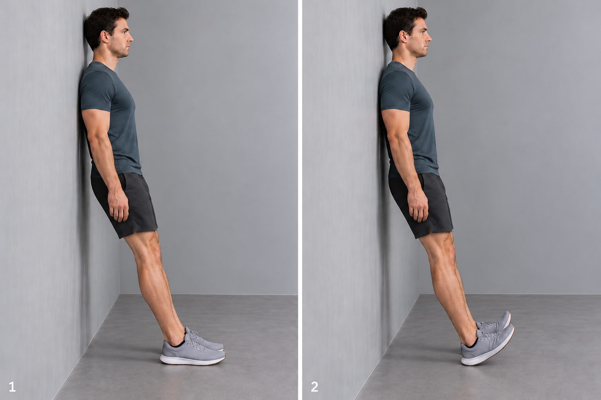
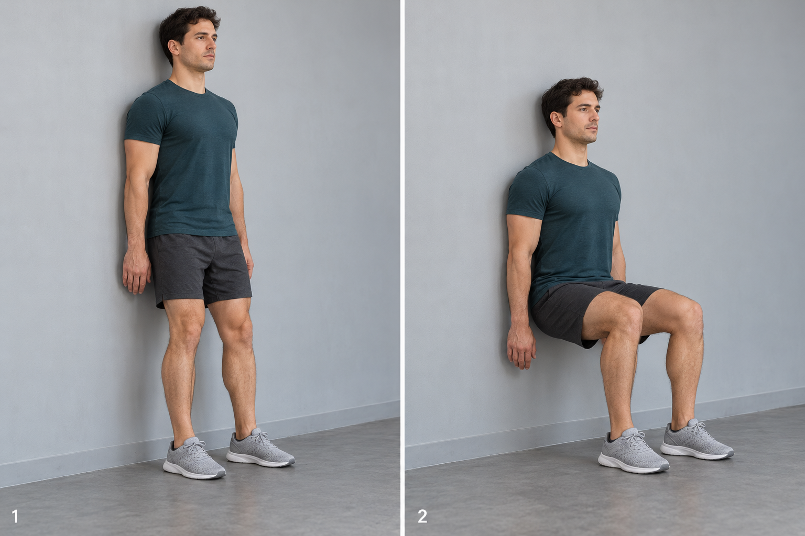
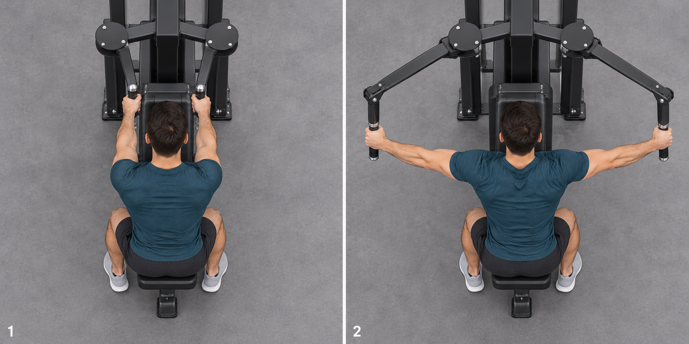
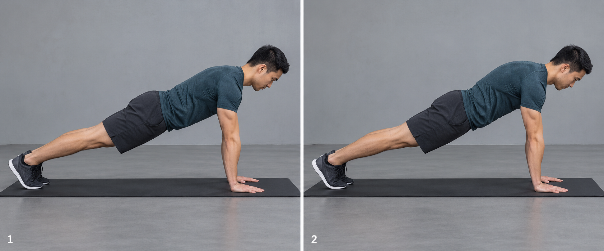

# 九动作本地循环示意候选

状态：候选已交付；未获所有者整批视觉确认，未接入生产。此目录没有客户端 import，不会随训练记录加载。素材来自既有 PM image_gen 输出，全部为 AI 示意，不是真人拍摄或视频截图；没有更换九条教学 URL。

打开 [index.html](index.html) 可离线查看本地双帧循环。Y/T/W、三向触点有阶段按钮，静蹲默认显示保持姿势；所有帧可单独查看，系统减少动态效果时默认静态。页面不发第三方请求。原图如下：

## 仰卧收下巴

后脑均接触垫面，下巴小幅后收、未抬头。细微动作请结合保留的真人视频对照。

SHA-256：`aa7501a0a1ffc7e0bbdb045149c165adfc2048eb2d1f6c3b0d658afe46c0cede`

## 俯卧 Y–T–W

首稿Y朝向不合格；v2俯视依次呈Y/T/W，胸部支撑、头颈中立、轻片，三对起止不遗漏T。

SHA-256：`0b18b8d101c8f6509c1e595009293756687a8943fae0fcdde9ef21673b4b981a`

## 胸椎伸展（泡沫轴版）

泡沫轴位于上背，双手托头，臀与足接地；作为已标注的泡沫轴替代版，未改原bench指南。

SHA-256：`fb30b45842ef5aced4ede2083a3b696542991d82b309fb3cd7d5bede03f7d59d`

## 单腿平衡三向触点

首稿悬空脚未触地；v2三个方向端帧脚尖接触标记、支撑脚保持、轻扶椅，不把触点当负重跨步。

SHA-256：`afa386a9e4d3b1cd56a6feb87a1b636d007482e3cf19d19ce52a6bc0a79081c0`

## 居家保加利亚分腿蹲（哑铃版）

后脚背搭凳，前脚全掌着地，前膝随脚尖，下蹲/高位对照；按本条哑铃替代版，原抱片计划不变。

SHA-256：`3e12934756e1a5abe58a6a921c77d56071e63dc0a7bcc72f5e6e8a57d9fda36a`

## 靠墙胫骨前肌抬脚尖

首两版离墙站位不足，不接入；v3脚跟明确向前离墙、背部有支撑，膝角保持，末帧脚跟着地且脚尖上抬。与原指南要点逐帧对照后进入本人过目候选。

SHA-256：`c50e0f86f2d1ccf448ee99d79d0206b1efd4ef93d69dff0bb4f45505da26a730`

## 靠墙静蹲

末帧背靠墙、髋膝约直角、全脚掌着地、手未撑大腿；静态保持动作，不伪作重复上下训练。

SHA-256：`661581e5f249759543b6459064b9f54a0957b6960f78ebbe4775d0a15116e939`

## 反向蝴蝶机

首稿双臂起始不一致；v2双臂前伸→对称侧开，面朝胸垫、不变划船，不用首稿。

SHA-256：`3b32a81a0f157b5bed2b22bf24b5386584bc15b72ce63fe6e993856335da13c6`

## 前锯肌 Push-up Plus

两帧肘均伸直，手/脚固定、髋未塌，上背由下沉到推出；细微肩胛变化保留真人视频解释。

SHA-256：`f4a82f8e99a2dfb419a5c79d1f4685e47b7ca4c84a6c2937b73cbcde9e87fd5a`

## 来源和核验范围

这些是 2026-10-20 候选的原始字节，不是新一轮生成。superseded 初稿不交付、不接入；选定文件/哈希见 manifest.json，原始生成与修正提示词见 image-prompts.json / image-corrections.json。

本轮逐张查看九张 sheet，核对姿势方向、器械和接触点；静态图与双帧交叉淡入不能证明实际运动轨迹准确，不能代替真人教程。收下巴和 Push-up Plus 的变化细微，不能用过大的位移假装运动。胸椎伸展是泡沫轴版、居家保加利亚是哑铃版，必须保留替代说明。

原始 20 个实拍/视频截帧 demo 不改。接入后的验证应覆盖 9 个指南实际关联、各阶段完整、静蹲等长保持、窄屏不截身体/器械、减少动态效果、开弹窗零 YouTube iframe 请求、原有外链与文字保留。生成来源/选定哈希写入 DATA-PLAN；不要导入整个 review-assets 目录。

上线前整批先审来源：plans.md 的 W6.2-PM-IMG 第 (2) 条：“上线前整批先交所有者本人过目，所有者点头后才接入 space-6”。本轮“不要内嵌 YouTube”是呈现方式决定，不是对未展示图像的视觉确认。

## 本轮验证限制

已核对 9 个选定原图 SHA-256 与旧清单一致。预览仅是离线设计交付，没有构建或发布。电脑锁屏导致浏览器不可用，本轮未验证页面实际渲染与动画，不能把静态源码检查称为真机通过。
